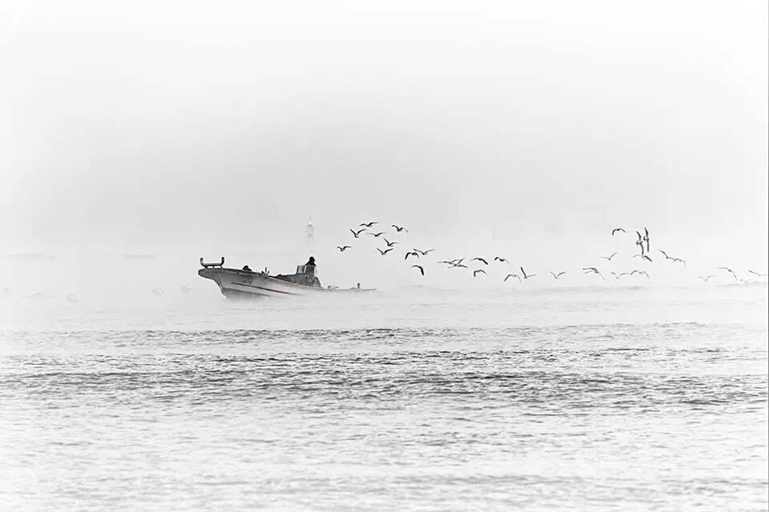
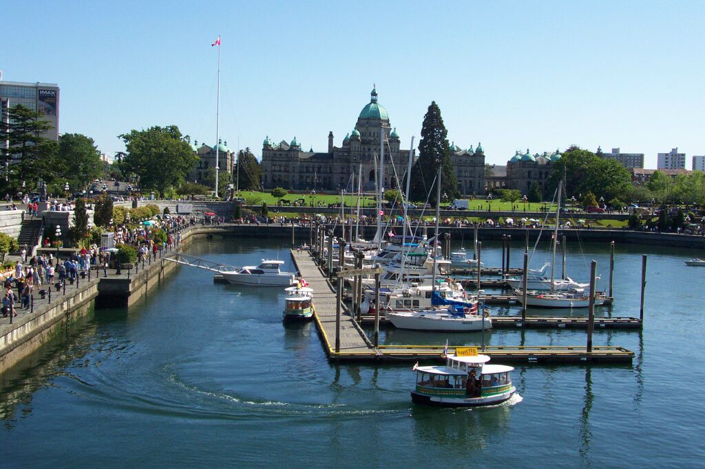

 ## Quiz-1 

[Quiz]: 다음 이미지에 대한 설명 중 옳지 않은 것은 무엇인가요?
- (1) 안개 속에서 보트가 물 위에 떠 있습니다.
- (2) 새들이 물 위를 날고 있습니다.
- (3) 배에는 두 명의 사람이 탑승해 있습니다.
- (4) 바다에 파도가 크게 일고 있습니다.

Listening: Which of the following descriptions of the image is incorrect?
- (1) A boat is floating on the water in the mist.
- (2) Birds are flying over the water.
- (3) There are two people on the boat.
- (4) The sea has large waves.

[Answer]: (4) 바다에 파도가 크게 일고 있지 않습니다.

---------------------

 ## Quiz-2 

[Quiz]: 다음 이미지에 대한 설명 중 옳지 않은 것은 무엇인가요?

- (1) 여러 척의 배가 정박해 있는 부두가 보입니다.
- (2) 멀리 녹색 지붕을 가진 건물이 보입니다.
- (3) 수많은 사람들이 잔디밭에 앉아 있습니다.
- (4) 이미지에서는 산이 뚜렷이 보입니다.

Listening: Which of the following descriptions of the image is incorrect?

- (1) There are several boats docked at a pier.
- (2) A building with a green roof is visible in the distance.
- (3) Many people are sitting on the grass.
- (4) A mountain is clearly visible in the image.

[Answer]: (4) 이미지에는 산이 보이지 않습니다.

---------------------

